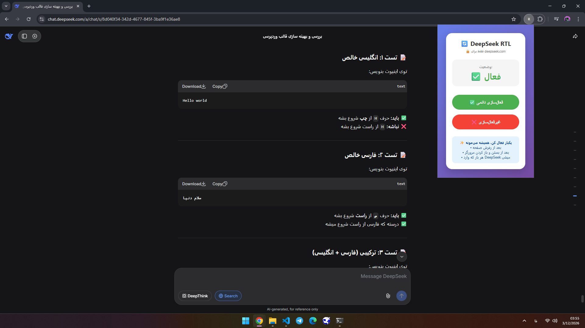

# 🔥 DeepSeek RTL - راست‌چین هوشمند برای DeepSeek

<div dir="rtl">

### 🎯 یک افزونه کروم برای راست‌چین کردن هوشمند متن‌های فارسی در DeepSeek

[](https://github.com/yourusername/deepseek-rtl)
[]()
[]()

</div>

---

## 📸 پیش‌نمایش
| قبل | بعد |
|:---:|:---:|
| ❌ متن فارسی از چپ نوشته می‌شود | ✅ متن فارسی از راست نوشته می‌شود |
| ❌ اعداد فارسی به هم ریخته هستند | ✅ اعداد فارسی درست نمایش داده می‌شوند |
| ❌ تجربه کاربری ضعیف | ✅ تجربه کاربری عالی |

---

## ✨ ویژگی‌ها

<div dir="rtl">

### 🌟 **هوشمند و خودکار**
- ✅ **فارسی** → راست‌چپ (با اولویت)
- ✅ **انگلیسی** → چپ‌چپ
- ✅ **اعداد فارسی** → راست‌چپ
- ✅ **کدهای برنامه‌نویسی** → چپ‌چپ (دست‌نخورده)
- ✅ **جواب‌های DeepSeek** → راست‌چپ

### 🔄 **یکبار فعال‌سازی، همیشگی**
- فقط یکبار دکمه فعال‌سازی رو می‌زنی
- تا همیشه می‌مونه (حتی بعد از رفرش و بستن مرورگر)
- هر بار که وارد DeepSeek میشی، خودش اعمال میشه

### 🎯 **مخصوص DeepSeek**
- فقط روی سایت `deepseek.com` کار میکنه
- بقیه سایت‌ها هیچ تغییری نمی‌کنن
- سبک و سریع

</div>

---

## 📥 نحوه نصب

### روش اول: نصب دستی (توسعه‌دهندگان)
1. 📥 فایل‌های افزونه رو دانلود کن
2. 🌐 برو به آدرس `chrome://extensions`
3. 🔧 کلید **Developer mode** رو فعال کن
4. 📂 کلیک کن روی **Load unpacked**
5. 📁 پوشه حاوی فایل‌ها رو انتخاب کن

### روش دوم: نصب از Chrome Web Store (به زودی)
به زودی در فروشگاه وب کروم منتشر خواهد شد.

---

## 🚀 نحوه استفاده

1. 🌐 برو به سایت [DeepSeek](https://deepseek.com)
2. 🧩 روی آیکون افزونه کلیک کن
3. 🔘 دکمه **"فعال‌سازی دائمی"** رو بزن
4. ✅ تمام! از این به بعد همه چی درسته

---

## 📸 اسکرین‌شات‌ها

| ![Screenshot 1]AlirezaM19999/Deepseek-rtl/blob/main/deepseek-rtl/screenshots/1.png) |  |
|:---:|:---:|
| *پنل افزونه* | *نمونه خروجی* |

---

## 🧪 تست سریع

<div dir="rtl">

### این متن‌ها رو توی اینپوت تست کن:

| متن | نتیجه مورد انتظار |
|:---|:---|
| `Hello World` | ⬅️ چپ‌چپ |
| `سلام دنیا` | ➡️ راست‌چپ |
| `سلام 123` | ➡️ راست‌چپ |
| `hello ۱۲۳` | ➡️ راست‌چپ |
| `I have 25 years old` | ⬅️ چپ‌چپ |

</div>

---

## 📁 ساختار پروژه

```text
📦 deepseek-rtl/
├── 📄 .gitignore             # فایل‌های نادیده گرفته شده در گیت
├── 📄 manifest.json          # تنظیمات اصلی افزونه
├── 📄 background.js          # سرویس کارگر پس‌زمینه (حافظه دائمی)
├── 📄 popup.html             # صفحه پاپ‌آپ
├── 📄 popup.js               # منطق پاپ‌آپ
├── 📄 README.md              # راهنمای پروژه
├── 📂 icons/                  # پوشه آیکون‌ها
│   ├── 🖼️ icon16.png          # آیکون 16x16
│   ├── 🖼️ icon32.png          # آیکون 32x32
│   ├── 🖼️ icon48.png          # آیکون 48x48
│   └── 🖼️ icon128.png         # آیکون 128x128
└── 📂 screenshots/            # پوشه اسکرین‌شات‌ها
    ├── 🖼️ 1.png     # تصویر پنل افزونه
    └── 🖼️ 2.png     # تصویر خروجی

---

## 🛠 تکنولوژی‌های استفاده شده

- **Manifest V3** - آخرین نسخه استاندارد افزونه‌های کروم
- **JavaScript ES6** - کد نویسی مدرن
- **Chrome Storage API** - ذخیره‌سازی وضعیت
- **Regex** - تشخیص کاراکترهای فارسی

---

## 👨‍💻 سازنده

این پروژه توسط **علی‌رضا** ساخته شده است.

🎨 **پورتفولیو:** [alireza-portfolio.businessman.workers.dev](https://alireza-portfolio.businessman.workers.dev/)

---

## 📞 ارتباط با من

- **ایمیل:** alisky102030@gmail.com
- **گیت‌هاب:** [@Alireza19999M](https://github.com/Alireza19999M)
- **تلگرام:** [@ali1999rm](https://t.me/ali1999rm)
- **🌐 پورتفولیو:** [alireza-portfolio.businessman.workers.dev](https://alireza-portfolio.businessman.workers.dev/)

---

## 📜 لایسنس

این پروژه تحت لایسنس **MIT** منتشر شده است.
